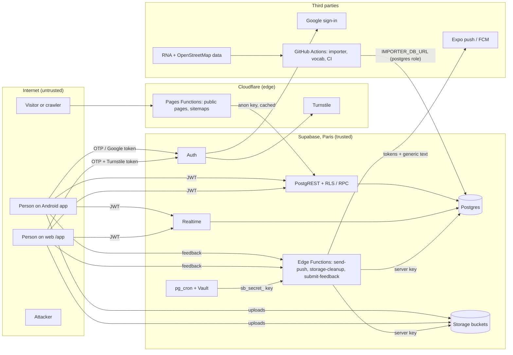

# Threat model

Last updated: 2026-11-20. Step 1.1 of the [improvement plan](../plans/2026-11-19-improvement-plan.md).

This document maps how data moves through Habituer, where the trust boundaries are, and which threats each part
faces. It uses STRIDE for security and LINDDUN for privacy. It does not repeat the
[pre-launch security review](2026-11-review.md) (finding ids DB-, AUTH-, WEB-, FN-, APP-) or the privacy impact
assessment ([docs/rgpd/aipd.md](../rgpd/aipd.md)); it points to them where a threat is already handled.

Each threat is marked **mitigated** (with the control or finding id), **accepted** (with the reason), or **open**.
Open threats get an id `TM-n` and are the targets of the next audit steps (1.2 to 1.7). As in the review, an open
threat without a concrete exploit path is "to verify" and is not rated high.

## Scope

**System.** Habituer helps people in France find activities and associations near them and meet regularly in small
groups.

**Assets, most sensitive first:**

1. Accounts and sessions: Supabase Auth users, refresh tokens, admin second factors.
2. Who meets whom: activity and collectif membership, attendances, invitations, blocks.
3. Group chat messages (kept 12 months).
4. Location: `profiles.home_area`, the explore location kept on the phone, activity places.
5. Reports, report snapshots, moderation decisions, admin audit log.
6. Association claim documents (identity proof, private bucket).
7. Feedback and screenshots; profile photos (public bucket).
8. Push tokens.
9. Secrets: database password, `sb_secret_` server key, Turnstile secret, Google OAuth secret, Expo and Firebase
   credentials, Android signing key, `IMPORTER_DB_URL`.
10. Availability and cost: database calls, Edge Function calls, GitHub Actions minutes.

**Compliance.** RGPD (French and EU users); the processing register and DPIA live in `docs/rgpd/`.

## Data flows

**Trust boundaries:**

- **B1, device to Supabase.** Everything the app sends is untrusted; only RLS, grants, `security definer` checks
  and Auth decide access. The publishable key in the app is public by design.
- **B2, internet to Cloudflare.** Public pages are anonymous; the edge cache and the rate-limit rule bound cost.
- **B3, Cloudflare to Supabase.** Pages Functions read as `anon` only; they hold no server key.
- **B4, cron to Edge Functions.** The cron jobs call `send-push` and `storage-cleanup` with the `sb_secret_` key
  from Vault; those functions run with `verify_jwt = false` and check the key themselves.
- **B5, Edge Functions to third parties.** Push tokens and generic notification text go to Expo and FCM (US).
- **B6, GitHub Actions to the database.** The importer and vocabulary jobs connect as the `postgres` role through
  the pooler.
- **B7, owner accounts.** Supabase, Cloudflare, GitHub, Google Cloud, Expo, Firebase and the domain registrar
  dashboards can change everything above.

## STRIDE by element

| Element | Threat | Status |
|---|---|---|
| Auth (B1) | **S**: guess or replay a sign-in code | mitigated: 8-digit code, 10 min, per-IP limits (AUTH-3); Turnstile on code request (WEB-8, owner setting) |
| Auth | **S**: password sign-in or pre-registration of someone's address | mitigated: password blanking trigger (AUTH-1, AUTH-2) |
| Auth | **S**: replay a stolen Google ID token | accepted (AUTH-6) |
| Auth | **E**: take over a new admin before they enrol their second factor | mitigated by procedure (AUTH-9) |
| Auth | **S**: hosted Auth settings left at defaults | **open, owner (Phase 0.1)**: the code assumes them |
| PostgREST + RLS (B1) | **I/E**: read or change another person's rows (BOLA) | mitigated by RLS and 30+ pgTAP files; **TM-1** for systematic coverage |
| PostgREST + RLS | **E**: `security definer` function trusts a parameter it should derive from `auth.uid()` | **TM-2**, to verify (step 1.3) |
| PostgREST + RLS | **T**: new column on `activities` or `collectifs` exposed or written without a grant review | known limitation (review); **TM-3** for a test that lists column grants |
| PostgREST + RLS | **D**: expensive search or RPC called in a loop | partly mitigated (creation and chat limits, `limit_log`); **TM-4** for per-user read limits, to verify |
| Realtime (B1) | **I**: subscriber receives `messages` rows of a discussion they are not in | mitigated if Realtime applies the `messages_select_group` policy to each subscriber; **TM-5** to verify on the local stack |
| Storage (B1) | **T/D**: upload unlimited or oversized files | mitigated (APP-2, size and type limits, random names) |
| Storage | **I**: read claim documents or feedback screenshots | mitigated: private buckets, admins only |
| Storage | **I**: location in photo metadata | accepted (APP-5) |
| Edge Function `submit-feedback` | **D/S**: spam, forged origin, huge body | mitigated (FN-2, FN-3, FN-4, FN-7) |
| Edge Functions `send-push`, `storage-cleanup` (B4) | **S**: call them without the key | mitigated: constant-time key check (FN-5) |
| Edge Functions (B4) | **E**: the cron shared secret is the full server key; a leak from Vault, logs or `net._http_response` gives full database access | accepted (FN-5, FN-6); **TM-6** to replace it with a dedicated cron secret |
| Push (B5) | **I**: notification text reveals names or messages on a lock screen or to Expo | mitigated: generic text ("Nouveau message") |
| Push | **T**: take over a push token | accepted (DB-8) |
| Pages Functions (B2, B3) | **T**: stored script injection through association or activity text | mitigated: escaping and JSON-LD escaping, tested with the `EVIL` fixture |
| Pages Functions | **D**: cache bypass, sitemap cost | mitigated (WEB-1, WEB-2); rate-limit rule is **open, owner (Phase 0.4)** |
| Pages Functions | **I**: stale page after moderation | accepted (WEB-6) |
| Web `/app` | **I**: session theft through script injection | accepted (AUTH-8): strict CSP, no inline scripts |
| GitHub Actions (B6) | **E**: a compromised action or dependency in the importer job reads `IMPORTER_DB_URL` and gets the `postgres` role on production | partly mitigated (APP-7: secret only in the steps that need it, pinned actions); **TM-7**: a least-privilege importer role |
| GitHub Actions | **T**: a workflow change or pull request from a fork runs with secrets | **TM-8**, step 1.7 |
| Dependencies | **T**: malicious npm or PyPI package in app, web, functions or importer | partly mitigated (Dependabot, `npm audit`, lockfiles); **TM-9**, step 1.6 |
| Owner accounts (B7) | **S/E**: a stolen dashboard login changes Auth, DNS, secrets or code | **TM-10, owner**: two-factor sign-in on every account |
| Database | **R**: an admin denies a moderation action | mitigated: admin audit log, kept 3 years |
| Database | **D/I**: data lost or restored wrongly | **TM-11, owner**: confirm the Pro daily backups and do one restore test on a copy |

## LINDDUN (privacy)

The DPIA (`docs/rgpd/aipd.md`) already lists risk sources (someone tracking a person, an outside attacker, a stolen
account, a malicious admin, a compromised sub-processor, a lost device) and the sub-processors. This table only adds
the technical view.

| Category | Threat | Status |
|---|---|---|
| **L**inkability | Combine public activity pages, member lists and photos to follow one person across groups | mitigated (DB-1, DB-2: no member identities or person ids for anonymous visitors) |
| **I**dentifiability | Work out where someone lives from `home_area` or from distances in search results | **TM-12**, to verify: check that no API returns another person's `home_area` or a distance to it |
| **N**on-repudiation | Chat messages and reports are tied to an account for a long time | accepted, limited by retention (12 months messages, 3 years reports) |
| **D**etectability | Learn whether an e-mail address has an account | mitigated (AUTH-1: no password sign-in; OTP answers the same either way) |
| **D**isclosure | A member of a collectif sees data of a person who blocked them | mitigated (block tests in `20_blocks_and_invites`) |
| **D**isclosure | Data stays in backups after an account is deleted | **TM-13**, to verify: say the backup delay in the privacy text |
| **U**nawareness | The web session lives in browser storage | open: privacy text must say so (AUTH-8 note) |
| **N**on-compliance | Retention jobs stop silently | **TM-14**: alert when a pg_cron job fails (check `cron.job_run_details`) |

## Open threats

| id | Threat | Severity | Next step |
|---|---|---|---|
| TM-1 | Missing BOLA tests on some tables or RPCs | closed 2026-11-20 | Signed-out surface pinned in `44_threat_model` (9 tables); update grants on `activities` checked: `organiser_id`, dates, moderation, embedding and welcome member are each held by a policy or trigger. Signed-in tables stay covered by the per-feature test files. |
| TM-2 | `security definer` function trusting a caller-supplied id | closed 2026-11-20 | 1.3 found none; it found DB-9 (unbounded search logs), now fixed |
| TM-3 | Column grants drift on `activities` and `collectifs` | closed 2026-11-20 | `44_threat_model` fixes the columns signed-out visitors can read |
| TM-4 | No per-user limit on expensive reads | to verify | 2.5: measure first; add limits only if a query is costly |
| TM-5 | Realtime leaking `messages` rows | closed 2026-11-20 | Only `messages` is published, with RLS (applied to INSERT events) and the default replica identity (DELETE events carry the id only); pinned in `44_threat_model`. A live two-user check was not run. |
| TM-6 | Server key used as cron secret | low | 1.2: dedicated secret in Vault and in the two functions |
| TM-7 | Importer runs as `postgres` | medium, fixed in code 2026-11-20 | Role `habituer_importer` (migration `20261120000053`, test `45_importer_role`); the importer's integration tests pass under it. **Owner:** push the migrations, set the role's password and switch `IMPORTER_DB_URL` (importer/README.md, "Secret"). |
| TM-8 | Workflow secrets reachable from untrusted triggers | closed 2026-11-20 | No `pull_request_target`, `workflow_run` or comment triggers; secrets only in the scheduled and manual import and vocabulary jobs; every action pinned to a commit |
| TM-9 | Malicious or abandoned dependency | partly closed 2026-11-20 | 1.6: no advisory in shipped code, two known install scripts; no per-maintainer review |
| TM-10 | Owner dashboards without two-factor sign-in | medium | Phase 0 (owner) |
| TM-11 | Untested backup restore | low | Phase 0 (owner) |
| TM-12 | Home location inferable | closed 2026-11-20 | `profiles` is readable by the person and admins only; `home_area` is read by no other function than the person's own export; tested in `44_threat_model` |
| TM-13 | Deleted data in backups not stated | low | privacy text |
| TM-14 | Silent failure of retention or cleanup jobs | low | a small monitoring query (still open) |

TM-7 is rated medium because the exploit path is concrete: a compromised third-party action or package in the
importer job reads the connection string and gets full control of the production database. TM-10 is medium
because one stolen password to Supabase or Cloudflare bypasses every control in this document.
